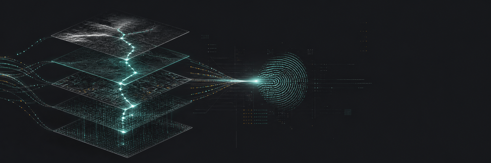
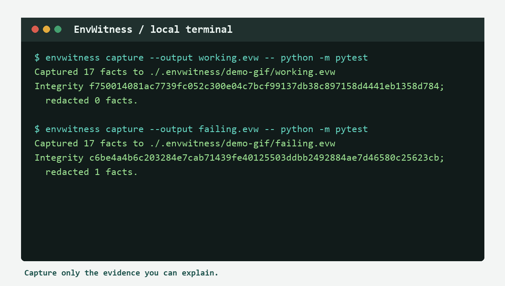
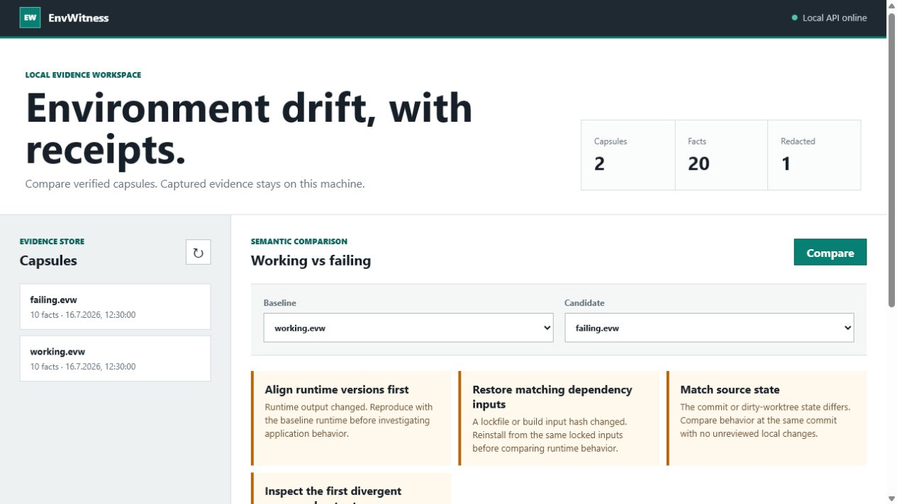
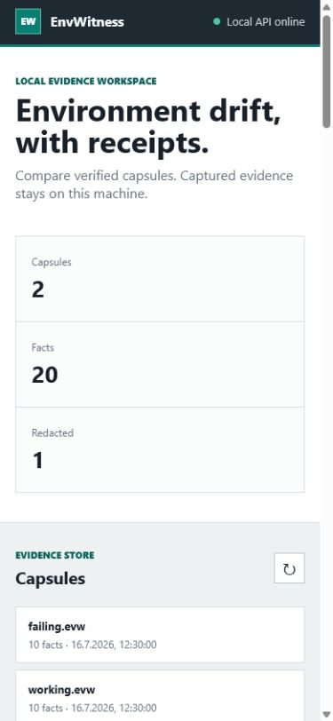
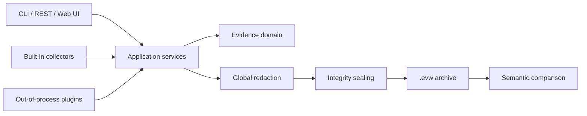

<p align="center">
  
</p>

<p align="center">
  
</p>

<h1 align="center">EnvWitness</h1>

<p align="center"><strong>Proof-carrying, privacy-first bug reports for the "works on my machine" gap.</strong></p>

<p align="center">
  <a href="https://github.com/nsergej/EnvWitness/actions/workflows/ci.yml"></a>
  <a href="https://github.com/nsergej/EnvWitness/releases"></a>
  
  <a href="LICENSE"></a>
  <a href="SECURITY.md"></a>
  
</p>

---

When software fails on one machine, the first hour is usually spent asking for the same facts: exact commit, dirty state, runtime versions, lockfiles, operating system, command output, and whether any of that can be shared safely.

EnvWitness turns those facts into a small `.evw` capsule. Every fact carries provenance, a sensitivity class, and a digest of the value that was actually stored. Secret patterns are removed before persistence. Two capsules can then be compared by semantic key, producing deterministic diagnostic hints instead of a wall of unrelated text.

```console
$ envwitness capture --output working.evw -- python -m pytest
Captured environment evidence to working.evw

$ envwitness capture --output failing.evw -- python -m pytest
Captured environment evidence to failing.evw

$ envwitness compare working.evw failing.evw
RUNTIME_DRIFT          Align runtime versions first
DEPENDENCY_INPUT_DRIFT Restore matching dependency inputs
COMMAND_OUTCOME_DRIFT  Inspect the first divergent command output
```

## Demo

<p align="center">
  
</p>

<p align="center">
  
</p>

<p align="center">
  
</p>

## Why EnvWitness

Ordinary support archives gather files. EnvWitness models diagnostic disclosure as a verifiable domain:

- **Proof-carrying facts**: value, collector, source, capture time, sensitivity, and stored-value digest travel together.
- **Minimum disclosure by default**: no hostname, username, remote URL, patch body, environment values, or file contents unless explicitly allowlisted.
- **Redact before persist**: one global deterministic pass covers built-in collectors and external plugins.
- **Semantic comparison**: facts are compared by stable keys, not archive paths or line order.
- **Privacy-safe integrity**: hashes cover redacted stored values; EnvWitness never leaves an offline oracle for discarded low-entropy secrets.
- **Portable evidence**: `.evw` is a bounded ZIP containing a validated JSON manifest and a readable Markdown report.
- **Offline-first**: CLI, REST API, and dashboard work locally. No account and no cloud are required.
- **Extensible without imports**: plugins are separate processes speaking a strict JSON protocol.

## Installation

### GitHub Release

```bash
pipx install https://github.com/nsergej/EnvWitness/releases/download/v1.0.0/envwitness-1.0.0-py3-none-any.whl
```

The release page also contains the source distribution, SPDX SBOM, SHA-256 checksums, and a GitHub build provenance attestation. Verify downloaded files as described in [Installation](docs/installation.md).

### Git tag

```bash
pipx install "git+https://github.com/nsergej/EnvWitness.git@v1.0.0"
```

### Source

```bash
git clone https://github.com/nsergej/EnvWitness.git
cd EnvWitness
python -m venv .venv
# Windows: .venv\Scripts\activate
# Linux/macOS: source .venv/bin/activate
python -m pip install -e .
```

### Docker

```bash
docker build -f docker/Dockerfile -t envwitness:1.0.0 .
docker run --rm --read-only --tmpfs /tmp -v "$PWD:/workspace" envwitness:1.0.0 capture --project-root /workspace --output /workspace/capture.evw
```

EnvWitness 1.0 is distributed through GitHub Releases and source tags, not PyPI. See [Installation](docs/installation.md) for PowerShell commands, checksum verification, and isolated development setup.

## Quick Start

Create a reviewed configuration:

```bash
envwitness init
```

Capture environment evidence only:

```bash
envwitness capture --config envwitness.yml --output support.evw
```

Capture a failing command without shell interpretation:

```bash
envwitness capture --output failing.evw -- python -m pytest tests/test_login.py
```

Inspect and verify before sharing:

```bash
envwitness verify failing.evw
envwitness inspect failing.evw
envwitness export failing.evw failing.md --format markdown
```

Compare a known working machine with a failing machine:

```bash
envwitness compare working.evw failing.evw --output difference.md
```

## Daily Workflows

### Maintainer issue template

Ask reporters for one command:

```bash
envwitness capture --output issue-123.evw -- your-command --with-arguments
```

The maintainer can run `envwitness verify`, inspect the generated report without extracting the archive, and compare it with a known-good capsule. Verification detects changes that were not followed by resealing; it is not a signature or proof of origin.

### CI failure evidence

```yaml
- name: Capture failure evidence
  if: failure()
  run: envwitness capture --output ci-failure.evw
- uses: actions/upload-artifact@v7
  if: failure()
  with:
    name: envwitness
    path: ci-failure.evw
```

### Local dashboard

```bash
export ENVWITNESS_API_TOKEN="$(python -c 'import secrets; print(secrets.token_urlsafe(32))')"
envwitness serve --config envwitness.yml
```

On PowerShell:

```powershell
$env:ENVWITNESS_API_TOKEN = python -c "import secrets; print(secrets.token_urlsafe(32))"
envwitness serve --config envwitness.yml
```

Open `http://127.0.0.1:8765`. Read operations need no token; state-changing API calls require the bearer token.

## Configuration

EnvWitness rejects unknown keys and unsafe paths.

```yaml
schema_version: "1.0"
project_name: payments-api

capture:
  command_timeout_seconds: 300
  maximum_output_bytes: 1048576
  include_environment_names: true
  environment_value_allowlist:
    - APP_MODE
  file_content_allowlist:
    - config/diagnostic.yml
  runtime_probes:
    - name: python
      command: [python, --version]
      timeout_seconds: 5

redaction:
  custom_rules:
    - name: internal-ticket
      pattern: "INC-[0-9]{8}"

plugins:
  - name: docker
    command: [envwitness-docker-plugin]
    enabled: true
    timeout_seconds: 10
    maximum_output_bytes: 262144

telemetry:
  enabled: false
  endpoint: ""
```

See [Configuration Reference](docs/configuration.md) for every field and threat boundary. The complete workflow guide is in [Usage](docs/usage.md).

## Architecture



Dependencies point inward. The domain contains evidence and integrity rules. Application services coordinate use cases through protocols. Infrastructure implements collection, redaction, archives, telemetry, and updates. Presentation owns CLI, HTTP, and browser concerns.

Read the [Architecture](docs/architecture.md), [Security Model](docs/security-model.md), [Security Audit](docs/security-audit.md), [Privacy Guide](docs/privacy.md), [Capsule Format](docs/report-format.md), and [Architecture Decision Records](docs/decisions.md).

## Plugin Protocol

Plugins never import EnvWitness internals. An explicitly enabled executable receives bounded JSON on standard input and returns:

```json
{
  "protocol_version": "1.0",
  "facts": [
    {
      "key": "plugin.docker.version",
      "value": "27.5.1",
      "source": "docker version --format",
      "sensitivity": "public"
    }
  ]
}
```

Plugin keys must start with `plugin.<configured-name>.`. Output is schema-validated, size-limited, and sent through the same global redactor as built-in evidence. Plugins are powerful local executables and remain disabled until explicitly enabled.

See [Plugin Authoring](docs/plugin-authoring.md) and the [working example](examples/plugins/runtime_inventory.py).

## REST API

The local API binds only to loopback addresses accepted by the configuration schema.

| Method | Path | Authentication | Purpose |
| --- | --- | --- | --- |
| `GET` | `/healthz` | None | Liveness |
| `GET` | `/api/v1/capsules` | None | List verified local capsules |
| `GET` | `/api/v1/capsules/{name}` | None | Read one verified manifest |
| `POST` | `/api/v1/capture` | Bearer token | Create a capsule |
| `POST` | `/api/v1/compare` | None | Compare two stored capsules |

Interactive OpenAPI documentation is served at `/api/docs`. See [API Reference](docs/api-reference.md) for request and response models, authentication, limits, and error behavior.

## Import and Export

```bash
envwitness export capture.evw capture.json --format json
envwitness import capture.json restored.evw
```

Import never invents a new digest. The JSON must satisfy schema `1.0`, every fact digest, and the manifest integrity record.

## Telemetry

Telemetry is off by default and requires two independent choices:

1. `envwitness telemetry enable` stores local consent.
2. Project configuration must set `telemetry.enabled: true` and an HTTPS endpoint.

Only allowlisted counts, operating system family, and EnvWitness version can be sent. Capsules, commands, paths, project names, collector values, and stable installation identifiers are never included. Consent can be withdrawn with `envwitness telemetry disable`. See [Privacy](docs/privacy.md) for the complete data inventory and review checklist.

## Updates

EnvWitness 1.0 does not publish a PyPI package, so its package-index updater is intentionally not an installation path for this release. Install a reviewed GitHub Release wheel or an exact Git tag. Automatic checking and installation remain disabled by default; the dormant updater configuration is retained for schema compatibility and a future package-index release.

## Roadmap

- **1.0**: evidence model, cross-platform collectors, deterministic redaction, verified archives, semantic comparison, plugin protocol, CLI, REST API, local dashboard.
- **1.1**: signed capsules with operating-system key stores and maintainer trust policies.
- **1.2**: first-party Docker, Kubernetes, Java, .NET, Node.js, and database plugins.
- **1.3**: privacy-preserving team baselines and machine-readable issue-template integration.
- **2.0**: pluggable diagnostic rule packs with reproducible scoring and stable compatibility guarantees.

The detailed plan lives in [Roadmap](docs/roadmap.md).

## FAQ

### Is a verified capsule proof that the reporting machine is trustworthy?

No. Integrity detects stored evidence changed without being resealed. Anyone who can modify a capsule can also recompute its ordinary SHA-256 digests. Version 1.0 does not provide signatures, hardware attestation, chain of custody, or proof that a collector was honest.

### Does EnvWitness guarantee that every secret is removed?

No redactor can make that guarantee. EnvWitness minimizes collection first, applies deterministic rules second, and makes review easy with `CAPSULE.md` and `envwitness inspect`. Treat any diagnostic archive as potentially sensitive.

### Why are environment values excluded by default?

Environment variables routinely carry credentials. Names provide useful configuration-shape evidence with much lower disclosure risk. Individual values require an exact allowlist and still pass through redaction.

### Why use process plugins instead of Python entry points?

The protocol works across languages, isolates dependency graphs, gives each plugin a clear timeout and output limit, and prevents plugins from relying on private package internals.

### Does EnvWitness upload capsules?

No. There is no upload command in `1.0`. Sharing remains an explicit operator action.

### Which operating systems are supported?

Windows, Linux, and macOS with Python 3.11, 3.12, or 3.13. CI tests every supported version on all three operating-system families.

## Contributing

Start with [CONTRIBUTING.md](CONTRIBUTING.md), the [Code of Conduct](CODE_OF_CONDUCT.md), and the curated [good first issues](docs/project-management.md#starter-issues). Public behavior changes require tests and documentation in the same pull request.

## Security

Please do not report suspected secret exposure in a public issue. Follow [SECURITY.md](SECURITY.md). The complete trust model and known limitations are documented in [docs/security-model.md](docs/security-model.md); the pre-release review and remediation record is in [docs/security-audit.md](docs/security-audit.md).

## License

EnvWitness is licensed under the [Apache License 2.0](LICENSE).
