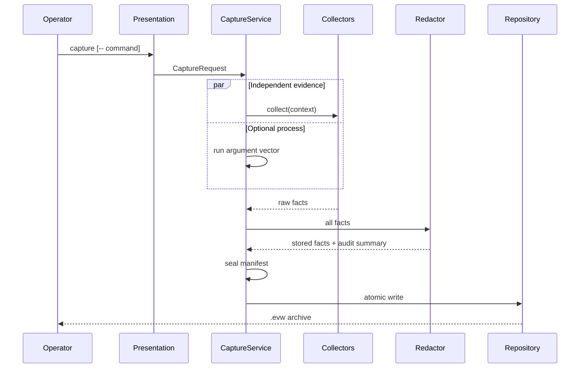

# Architecture

EnvWitness uses Clean Architecture boundaries with dependency direction toward the domain.

## Layers

### Domain

`src/envwitness/domain` owns evidence facts, sensitivity, command metadata, capsule integrity, semantic differences, and diagnostic hints. Models are immutable and reject unknown fields.

### Application

`src/envwitness/application` owns capture, comparison, and rendering use cases. Infrastructure is accessed through protocols: collectors, command runner, redactor, repository, and telemetry sink.

### Infrastructure

`src/envwitness/infrastructure` implements operating-system collection, process execution, YAML loading, global redaction, plugin execution, archive safety, opt-in telemetry, and package updates.

### Presentation

`src/envwitness/presentation` contains the Typer CLI, FastAPI service, and static local dashboard. It validates transport-specific inputs and delegates business decisions to application services.

## Capture Sequence

## Error Strategy

- Domain and use-case errors inherit from `EnvWitnessError` and contain safe operator messages.
- External exceptions are translated at infrastructure boundaries with the original exception chained.
- CLI failures use exit code `1`; invalid Typer syntax uses standard CLI exit code `2`.
- API input errors return `422`, missing capsules return `404`, unauthorized mutations return `401`, and mutation configuration absence returns `503`.
- Telemetry delivery is intentionally non-critical and can never fail a capture.

## Performance Boundaries

- Independent collectors execute concurrently.
- Captured standard output and standard error are drained concurrently with bounded retention.
- Runtime probes execute concurrently and have per-probe timeouts.
- Plugin output, archive size, expanded size, configuration size, file content, and command output all have explicit limits.
- Lockfile hashing streams content in 64 KiB chunks.
