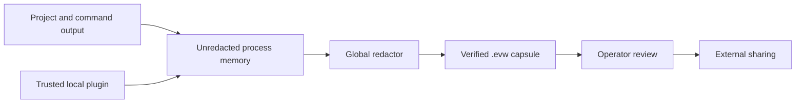

# Security Model

EnvWitness handles developer environment evidence, which must be treated as potentially sensitive even after redaction. The design minimizes collection first, sanitizes second, and requires human review before sharing.

## Security goals

- Do not collect identity, remote URLs, environment values, patches, or file contents by default.
- Apply one deterministic redaction pass to every built-in, command, and plugin fact before persistence.
- Detect modification of stored values and the manifest.
- Reject malformed, traversing, encrypted, duplicate, oversized, or unexpected archive members.
- Keep the bundled HTTP service on loopback and authenticate mutations.
- Keep telemetry inert until two independent opt-in controls are enabled.
- Execute configured commands without shell interpolation.

## Trust boundaries

The running EnvWitness process, operating system, Python interpreter, and explicitly enabled plugins are trusted. Capsules received from another party are untrusted input and are validated before use. The local dashboard is trusted only on the same machine.

## Redaction policy

Built-in rules cover private key blocks, authorization headers, GitHub-style tokens, OpenAI-style keys, AWS access key identifiers, JWT-shaped values, credential-bearing URLs, and common secret assignments. Facts classified as `secret` are replaced completely. Operator rules can add organization-specific patterns.

Redaction is not a proof that a document contains no secret. Unknown formats, encoded data, and contextual business information can remain. Always run `envwitness inspect` or read `CAPSULE.md` before sharing.

## Integrity guarantees

Each fact contains a SHA-256 digest of its stored, post-redaction JSON value. The capsule contains a SHA-256 digest over its canonical unsigned manifest. Verification detects accidental or deliberate changes after sealing.

Integrity does not authenticate the reporting machine, collector, or person. Version 1.0 does not provide signatures, hardware attestation, or a chain of custody.

## Archive controls

- Maximum compressed archive: 25 MiB.
- Maximum expanded content: 50 MiB.
- Allowed members: `manifest.json` and `CAPSULE.md`.
- Absolute paths, parent traversal, duplicate names, encrypted members, and symlink overwrite targets are rejected.
- Writes use a temporary file followed by an atomic replacement.

## Process controls

Commands and plugins receive argument arrays and never pass through a shell. Output retention, execution time, file disclosure, runtime probes, and plugin responses are bounded. Plugin environment inheritance is reduced to process-discovery and temporary-directory variables.

Plugins remain arbitrary trusted executables with the current user permissions. Install only reviewed plugins and pin their distribution in managed environments.

## Local API

The YAML schema rejects non-loopback hosts. Capsule names and storage paths are constrained to the fixed project root. Capture requires a constant-time bearer-token comparison. Listing, reading, and comparison are unauthenticated because the server is local; do not expose it through a proxy or port-forwarding system.

## Telemetry and updates

Telemetry sends only allowlisted aggregate counters, operating-system family, and tool version. There is no installation identifier. Network failures are non-critical.

Updates query only the canonical PyPI HTTPS metadata endpoint, validate versions with PEP 440 semantics, reject automatic pre-releases, and install one exact version through the active interpreter. Package-index and local Python trust still apply.

## Reporting vulnerabilities

Follow [`SECURITY.md`](../SECURITY.md). Never attach a capsule containing real secrets to a public issue.
